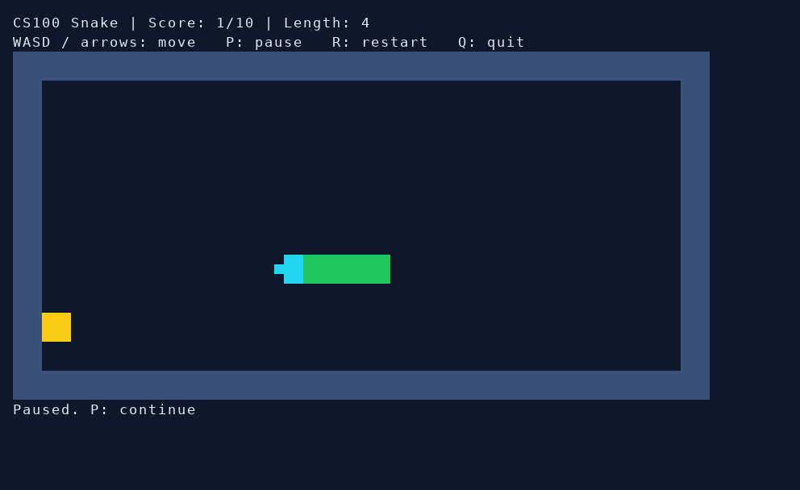
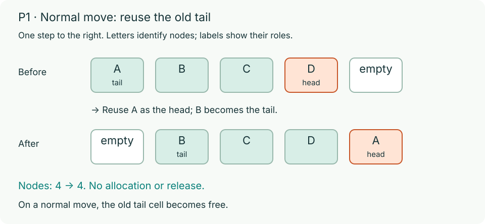
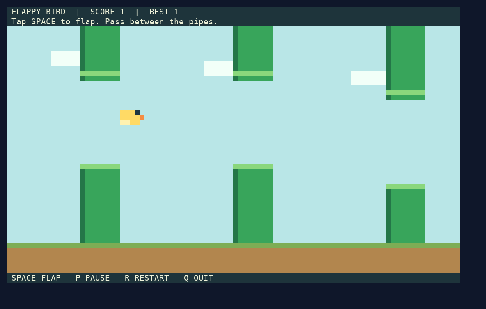
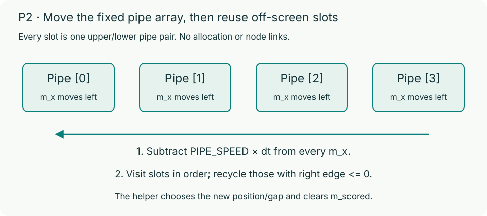
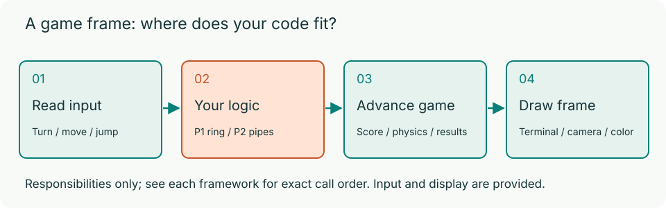
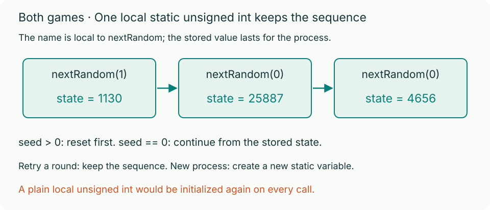
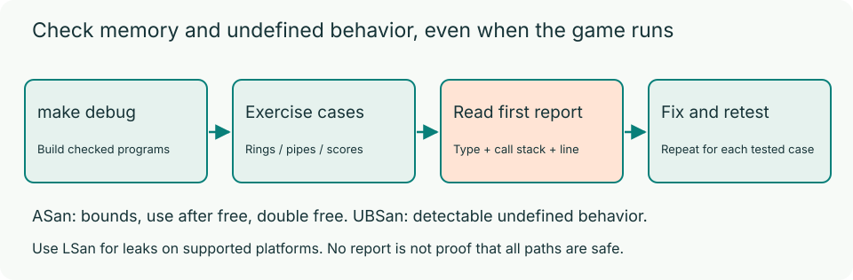

# CS100 Fall 2026 HW4: Two C Games

Welcome to HW4! In this assignment, you will complete two playable terminal games in C17: **P1: Circular-list Snake (40 automatic points)** and **P2: Flappy Bird (40 automatic points)**. This is individual work, and there are no separate objective questions. Automatic tests award 80 points; the separate staff check and code organization block awards 20 points.

## What you build

In **P1 (Snake)**, use a circular singly linked list where `m_head->m_next` is the tail. Normal movement reuses that tail as the new head; growth adds one node.




In **P2 (Flappy Bird)**, you tap **Space** to flap while the pipes scroll left automatically. The bird stays at a fixed horizontal coordinate (`BIRD_X`). You fly through pipe gaps and score each passed pipe once. Space also starts the first round and retries after a crash; the game needs no direction-key combinations or key-release events.




Both games are silent. The screenshots above use a sample terminal font; exact visual proportions depend on your terminal.

## Your files

| File | Functions to complete | Points |
| --- | --- | ---: |
| `p1/snake.c` | `snakeInit`, `snakeNextPosition`, `snakeContains`, `snakeStep`, `snakeDestroy`, `nextRandom` | 40 automatic |
| `p2/flappy.c` | `advancePipes`, `birdHitsObstacle`, `scorePassedPipes`, `nextRandom` | 40 automatic |

By default, you only edit `p1/snake.c` and `p2/flappy.c`. The public headers (`p1/snake.h` and `p2/flappy.h`) define all public types and constants. The framework already handles the main loops, keyboard input, terminal rendering, timing, and result screens, plus gravity, flapping, random gap generation, and retry in P2.



Keep the required file paths, public types, and function signatures unchanged. You may add `static` helpers or extra C files. P1 must use the provided circular linked list; P2 uses the fixed `m_pipes` array and needs no dynamic allocation.

```text
hw4/
  README.md, Makefile, .clang-format
  docs/                    Requirements, diagrams, debugging and grading
  p1/snake.c               Your 6 functions
  p1/snake.h               P1 interface
  p2/flappy.c              Your 4 functions
  p2/flappy.h              P2 interface
  p2/framework/            Provided game systems
```

## Build and play

You need a C17 compiler, Make, and a UTF-8 ANSI terminal on macOS or Linux. On macOS, run `xcode-select --install`. On Ubuntu or Debian, install `build-essential`. You do not need any specific editor workspace or external libraries.

From `hw4/`, build and run one game at a time:

```bash
make debug
(cd p1 && ./build/snake-debug)
(cd p2 && ./build/flappy-debug)
```

`make debug` compiles with `-O1 -g`, AddressSanitizer (ASan), and UndefinedBehaviorSanitizer (UBSan). `make release`, or plain `make`, builds optimized executables at `p1/build/snake` and `p2/build/flappy`. Debug and release builds use separate output paths.

The Snake starter exits because `snakeInit` returns `false`. Initialization alone does not make it playable: the `snakeStep` stub ends the first movement tick with an out-of-memory result. Complete all six functions for correct play, food placement, and cleanup. The Flappy Bird starter can already draw the window and read Space, but pipe movement, collision detection, and scoring remain incomplete.

| Action | P1: Snake | P2: Flappy Bird |
| --- | --- | --- |
| Play | WASD or arrow keys turn | Tap Space to flap |
| Start / retry | R restarts | Space starts or retries |
| Pause / restart / quit | P / R / Q | P / R / Q |

> **Tip:** If Snake grid cells look stretched in your terminal, run `./build/snake --calibrate` inside `p1/`, adjust the width with `+` or `-`, and press Enter. Do not commit the generated `.snake-ui.conf` file.

## Random state in both games

Implement `nextRandom(unsigned int seed)` separately in both solution files, using one function-local `static unsigned int` initialized to `RANDOM_INITIAL_SEED` (`100`).

- If `seed > 0`, first reset the state to `seed % RANDOM_MODULUS`. If `seed == 0`, keep the current state.
- Then update the state to `(RANDOM_MULTIPLIER * state + RANDOM_INCREMENT) % RANDOM_MODULUS` (`(109 * state + 1021) % 32768`) and return the new state.
- The framework seeds the generator once when the program starts; restarting a round continues the same sequence. Do not use global variables, struct fields, `rand`, or `srand`. See [P1](docs/p1.md) and [P2](docs/p2.md) for worked examples.



## Read, implement, and test

Start with the [Overview](docs/description.md), the public headers, and the full [P1](docs/p1.md) and [P2](docs/p2.md) specifications:

See [Circular lists](docs/linkedList.md) for P1's representation and invariants.

Always test with the debug builds (`snake-debug` and `flappy-debug`). ASan catches memory bugs (out-of-bounds access, use-after-free, double free), LSan checks for memory leaks where supported, and UBSan catches undefined behavior. When a sanitizer prints a report, read the first error's type, call stack, and line number, fix that root cause, rebuild, and retest. See [Debugging](docs/debugging.md).



Design your own boundary tests in addition to playing.

## Style gate

Follow the course naming rules and use named constants instead of magic numbers:

- Types: `UpperCamelCase`
- Functions, variables, parameters: `lowerCamelCase`
- Struct members: `m_lower_case`
- Constants and enum values: `UPPER_SNAKE_CASE`

Format your code with the provided Recitation 0 `.clang-format` (LLVM style, 4-space indent, 100-column limit). VS Code users can use the included workspace settings for format-on-save with the Microsoft C/C++ extension, or you can run `clang-format-18` directly from `hw4/`:

```bash
clang-format-18 -i p1/snake.c p2/flappy.c
```

If you add any extra C files or headers, format them too. Do not modify `.clang-format` or use `clang-format off/on` comments.

> **Important:** Online grading runs `clang-format` 18 with the course config on each problem separately. **If P1 fails formatting, P1 gets 0 automatic points (P2 is unaffected, and vice versa).** Fix any reported formatting diff and resubmit. Code organization (naming, constants, and clean ownership) is also reviewed manually.

## Submit a clean repository

Put the complete `hw4/` directory at the root of your GitHub repository and submit the repository to [HW4_programming](https://www.gradescope.com/courses/1402185/assignments/8980667) on Gradescope. Check Gradescope and course announcements for the deadline.

| Assessment | Points |
| --- | ---: |
| P1 automatic tests | 40 |
| P2 automatic tests | 40 |
| Staff check and code organization | 20 |
| Total | 100 |

> **Important:** **Submitting a nonempty `build/` directory (at any depth), compiled binaries/objects, or explicitly prohibited generated or cache files gives 0 for all 80 automatic points.** An empty `build/` directory is fine, but a `build/` with `.gitkeep` counts as nonempty. Executables without file extensions and the downloaded starter ZIP are also prohibited. Normal images and other static assets are allowed. See [Code style and repository rules](docs/code-style.md).

Before every commit and submission, run these commands in `hw4/`:

```bash
make clean
git status --short
git ls-files
```

Check the output of `git ls-files` carefully—remember that `.gitignore` does not untrack files that were already committed earlier.

### Extensions and staff check

Helper functions and custom game variants are welcome:

- Put C helpers used by your graded solution inside `p1/` or `p2/` and add them to that problem's `Makefile`.
- Put standalone extra programs or custom entry points in `p1/extras/`, `p1/extensions/`, `p2/extras/`, or `p2/extensions/`.
- Format all added student C code with `clang-format-18`. Large directory layout changes trigger staff review, not an automatic layout penalty. Required paths, interfaces, and core behavior must remain intact. Missing required solution files, broken interfaces, or build failures give the affected problem 0 automatic points.

Each problem has an in-person staff check on your last submission where you must explain and modify your own code. Each check is 6 points; code organization is 4 points per problem. See [Grading](docs/grading.md).
