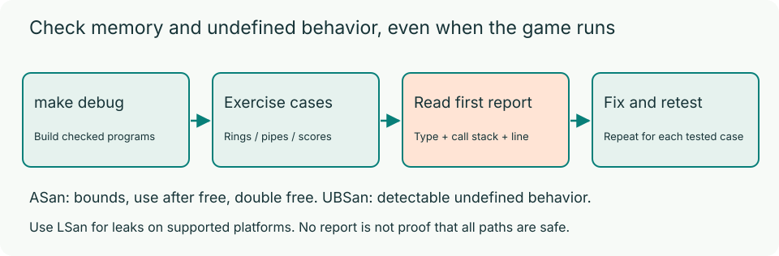

# Debugging with Sanitizers

C code can look correct on screen while accessing invalid memory. AddressSanitizer (ASan) catches memory errors; UndefinedBehaviorSanitizer (UBSan) catches detectable undefined behavior.



## Build and run

From `hw4/`, run one game at a time:

```bash
make debug
(cd p1 && ./build/snake-debug)
(cd p2 && ./build/flappy-debug)
```

You can also build inside either problem directory. The starter functions are incomplete; see each problem's handout. Press `Q` to quit normally so exit cleanup can run.

| Mode | Build command | P1 executable | P2 executable |
| --- | --- | --- | --- |
| Debug | `make debug` | `p1/build/snake-debug` | `p2/build/flappy-debug` |
| Release | `make release` or `make` | `p1/build/snake` | `p2/build/flappy` |

Debug and release outputs are separate. Release uses `-O2`; debug uses:

```text
-O1 -g -fno-omit-frame-pointer
-fsanitize=address,undefined -fno-sanitize-recover=all
```

These options retain source locations and useful call stacks and stop at the first detected error. If sanitizer runtimes are missing, install the matching compiler runtime or use a compiler that includes it.

## What the tools detect

| Tool | Examples |
| --- | --- |
| ASan | Out-of-bounds access, use after free, double free, invalid free |
| UBSan | Signed overflow, misaligned access, detectable null-pointer-related operations |
| LeakSanitizer (LSan) | Unreleased allocations at exit, on supported platforms |

Sanitizers only inspect paths that execute. A quiet run is not proof of correctness. Design your own boundary tests in addition to playing.

On Linux with LSan support, run from `hw4/`:

```bash
(cd p1 && ASAN_OPTIONS=detect_leaks=1 ./build/snake-debug)
(cd p2 && ASAN_OPTIONS=detect_leaks=1 ./build/flappy-debug)
```

> **Note:** LSan availability varies by OS, architecture, and compiler. Regardless of local support, every allocation your code owns must be released.

## Reading reports

Fix the first report's root cause before chasing later symptoms. Read its error type, source location, and relevant allocation/free call stacks. Rebuild and rerun after fixing it; do not suppress reports by disabling sanitizers.

The terminal UI may obscure a report. Save standard error outside your repository:

```bash
(cd p1 && ./build/snake-debug 2>/tmp/hw4-p1-sanitizer.log)
cat /tmp/hw4-p1-sanitizer.log
```

If an abnormal exit leaves the terminal unusable, run `stty sane` and, if needed, `reset`. Do not commit logs or executables.

> **Important:** Put custom drivers with their own `main` in that problem's `extras/` or `extensions/` directory, not directly in `p1/` or `p2/`. Otherwise they conflict with the grader's test entry point, causing a link failure and zero automatic points for that problem.

## Online grading

Online functional tests use ASan and UBSan. A detected memory error or undefined behavior fails the affected test item, without a separate sanitizer penalty. Both harnesses directly check unreleased allocations rather than relying on LSan's exit scan; P1 also checks node allocation and release behavior.

Sanitizer checks do not replace the per-problem clang-format 18 gate or the [repository rules](code-style.md). Run `make clean` before submission; nonempty `build/` directories are prohibited.
