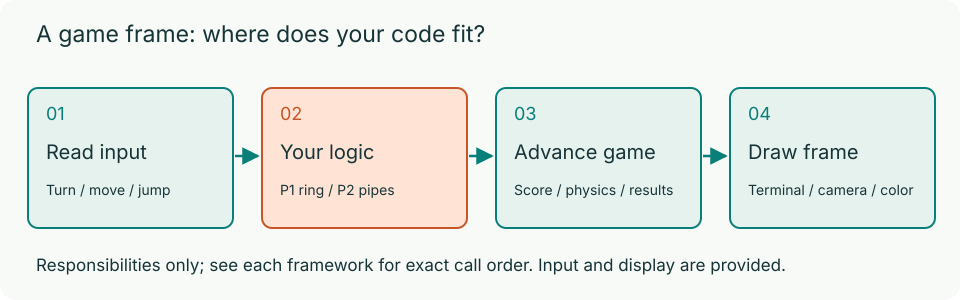
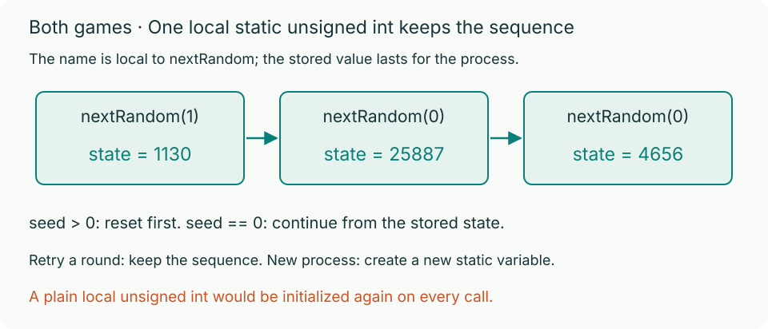

# HW4: Two C Games

In this assignment, you will build the core game logic for two playable terminal games in C17: **P1: Circular-list Snake (40 automatic points)** and **P2: Flappy Bird (40 automatic points)**, plus **20 points for the staff check and code organization**. This is individual work, and there are no separate objective questions. You will practise circular linked lists and memory ownership in P1, fixed arrays, boundary conditions, and one-time flags in P2, and a function-local `static` state in both problems.

## At a glance

| Problem | Student file | Required work | Points |
| --- | --- | --- | ---: |
| P1: Circular-list Snake | `p1/snake.c` | Create, query, move, grow, and destroy a circular linked list, and keep random state (6 functions: `snakeInit`, `snakeNextPosition`, `snakeContains`, `snakeStep`, `snakeDestroy`, `nextRandom`) | 40 automatic |
| P2: Flappy Bird | `p2/flappy.c` | Advance and recycle pipes, detect collisions, count new points, and keep random state (4 functions: `advancePipes`, `birdHitsObstacle`, `scorePassedPipes`, `nextRandom`) | 40 automatic |

## What is provided and what you write

You do not need to build a game engine from scratch. The framework already provides the main loops, keyboard input, timing, terminal drawing, colors, and result screens. In P2, the framework also handles gravity, flapping physics, random gap generation, and round retries. Read the public headers (`p1/snake.h` and `p2/flappy.h`) to see what types and constants exist and when the framework calls your functions.

Every visible action on screen comes from a small change in your data structures:

- **Snake** uses a circular linked list. Normal movement reuses the old tail as the new head; growth adds one node.
- **Flappy Bird** uses a fixed array of pipe pairs, collision boxes, and a flag that prevents repeated scoring.



By default, you only edit `p1/snake.c` and `p2/flappy.c`. You may add `static` helper functions or extra C files, as long as you keep the required file paths, public types, and function signatures intact. P1 must use the provided circular linked list (`Snake` and `SnakeNode`). P2 uses the provided fixed array (`m_pipes[PIPE_COUNT]`) and needs no dynamic memory allocation.

## Get started

You need macOS or Linux with a C17 compiler, Make, and a UTF-8 ANSI terminal. On macOS, run `xcode-select --install` to get the command-line tools. On Ubuntu or Debian, install the `build-essential` package. You do not need any particular editor or workspace, and both games are silent.

From the extracted `hw4/` directory, build and run one game at a time:

```bash
make debug
(cd p1 && ./build/snake-debug)
(cd p2 && ./build/flappy-debug)
```

`make debug` compiles with debug symbols, AddressSanitizer (ASan), and UndefinedBehaviorSanitizer (UBSan). `make release`, or plain `make`, builds the normal optimized executables at `p1/build/snake` and `p2/build/flappy`. Debug and release modes write to separate output files.

Here is the directory structure inside `hw4/`:

```text
hw4/
  README.md, Makefile, .clang-format
  docs/                       # Full handout, figures, debugging and grading
  p1/snake.c                  # Your 6 functions
  p1/snake.h                  # Public types, constants and interfaces
  p2/flappy.c                 # Your 4 functions
  p2/flappy.h                 # Public types, constants and interfaces
  p2/framework/               # Provided input, physics, drawing and game flow
```

Before you write your code, the two starter programs behave differently:

- The **Snake** starter exits with a setup message because `snakeInit` returns `false`. Implementing initialization alone does not make it playable: the `snakeStep` stub ends the first movement tick with an out-of-memory result. Complete all six functions for correct play, food placement, and cleanup.
- The **Flappy Bird** starter already draws the window and accepts Space to flap, but pipe movement, collision detection, and scoring do nothing until you complete your functions.

> **Note:** The terminal renderer uses ANSI truecolor and half-block characters. Exact visual proportions depend on your terminal font and line spacing, and these visual details are not graded. Flappy Bird only reads single keypresses; it does not need simultaneous direction keys or key-release detection.

## Try the finished games

Want to see the goal before you start? Download [`HW4_demos.zip`](https://vsplab.cn/courses/cs100/hw4/HW4_demos.zip) from the HW4 page. It contains playable reference programs for both games (programs only, no source code):

| Folder | Platform |
| --- | --- |
| `hw4-demo/linux-x86_64/` | Linux on x86_64 with glibc 2.34 or newer (for example Ubuntu 22.04 or later) |
| `hw4-demo/macos-arm64/` | macOS 11 or newer on Apple Silicon; Intel Macs are not supported |

From the folder that contains `hw4-demo/`, run one game at a time. On Linux:

```bash
(cd hw4-demo/linux-x86_64/p1 && ./snake)
(cd hw4-demo/linux-x86_64/p2 && ./flappy)
```

On a Mac with Apple Silicon:

```bash
(cd hw4-demo/macos-arm64/p1 && ./snake)
(cd hw4-demo/macos-arm64/p2 && ./flappy)
```

> **Tip:** These demos are not notarized by Apple, so macOS may block them after download. If that happens, run `xattr -dr com.apple.quarantine hw4-demo` once from the same folder, then try again. If a program says permission denied, run `chmod +x` on it.

Keep the demo ZIP and the extracted `hw4-demo/` folder outside your homework repository: the programs inside are compiled executables.

## Read and develop

Read the public headers and the [P1](p1.md), [P2](p2.md), and [circular-list](linkedList.md) contracts. Design your own boundary tests and use the debug builds while developing.

Both games require `nextRandom(unsigned int seed)` with one function-local `static unsigned int` state. The problem statements give its constants, recurrence, seed rules, and examples.



## Submit and explain your code

Place the complete `hw4/` directory at the root of your GitHub repository, and submit the whole repository to [HW4_programming](https://www.gradescope.com/courses/1402185/assignments/8980667) on Gradescope.

Grading is split into **80 automatic points** (40 for P1, 40 for P2) and **20 manual points** for the staff check and code organization. Each problem has an in-person staff check on your last submission where you must explain and modify your own code. Each check is 6 points; code organization is 4 points per problem.

> **Important:** Check the formatting and repository gates before you submit:
>
> - **Formatting gate (per problem):** Your student code is checked with `clang-format` 18 using the Recitation 0 configuration. If a problem fails the formatting check, that problem receives **0 automatic points** (the other problem is graded independently).
> - **Repository cleanliness gate (whole assignment):** Submitting any prohibited generated or cache files—including a nonempty `build/` directory at any depth (even a `build/` containing only `.gitkeep`), compiled binaries, or object files—gives **0 out of 80 automatic points** for the entire assignment. Empty `build/` directories are fine.

Extra helper functions and creative game variants are welcome as long as they do not replace or break the required core tasks. For full details, read [Code style and repository rules](code-style.md), [Debugging](debugging.md), and [Grading](grading.md).

