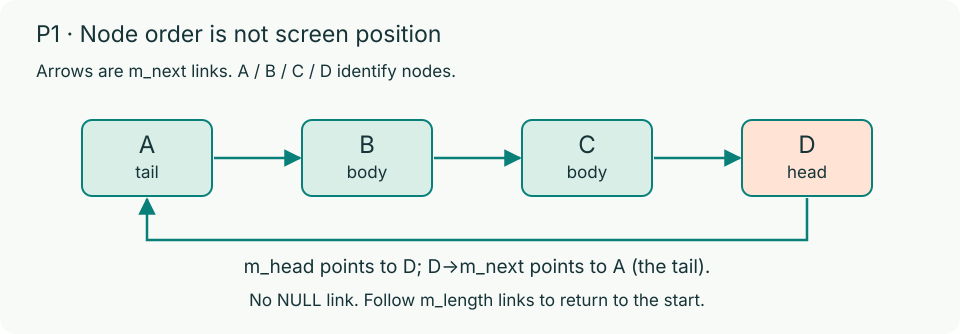

# Circular Lists for P1: Snake

P1 uses a singly linked circular list. Nodes are separately allocated, unlike array elements. The last link returns to the first node instead of ending at `NULL`.

## The Snake ring

`Snake` stores one entry pointer, `m_head`, and a node count, `m_length`. **`m_head->m_next` is the tail.** Links run from tail through body to head, then back to tail.

Every valid snake satisfies these invariants:

- **Empty:** `m_head == NULL` and `m_length == 0`.
- **One node:** `m_length == 1` and `m_head->m_next == m_head`.
- **Length `n`:** following exactly `n` links from any node returns to that node, with no `NULL` links or earlier return.

## Movement and ownership

A normal move reuses the old tail as the new head. It does not allocate, free, or shift coordinates across the body. Growth keeps the old tail in place and adds one new head node. Both operations must preserve the ring.

The head may enter the old tail cell during a normal move because the tail leaves it. During growth, that cell remains occupied and causes `STEP_SELF`.

> **Important:** A failed `snakeStep` leaves the original snake unchanged. A failed `snakeInit` releases its partial allocations and leaves a zeroed snake.

`snakeDestroy` must release every node exactly once and zero all fields. It must be safe on empty snakes and when called repeatedly. See [P1](p1.md) for the full function contracts.

## Testing

Design your own boundary tests and run them with [sanitizers](debugging.md). A playable game alone does not establish that the ring and memory ownership are correct.
