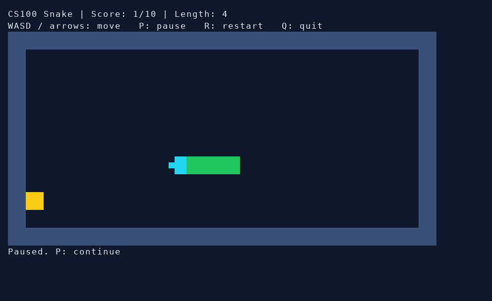
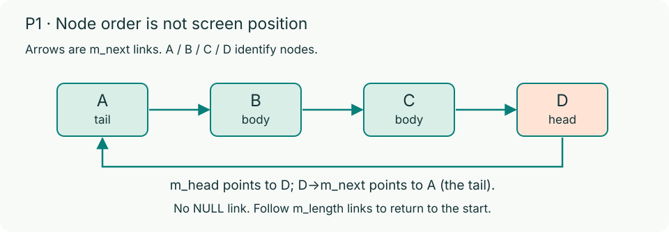
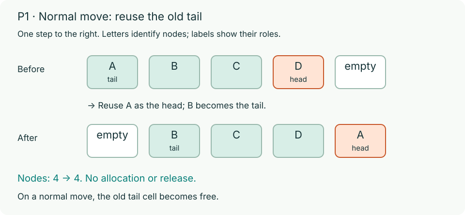
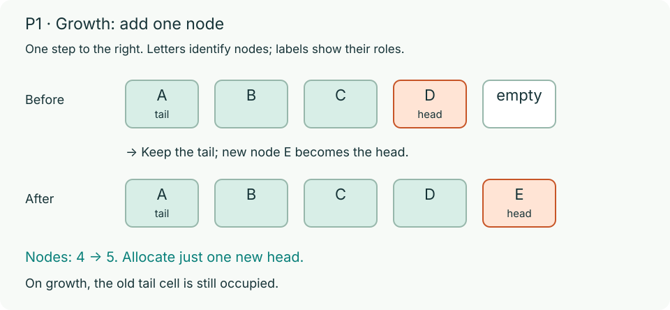

# Problem 1: Circular-list Snake (40 automatic points)

Complete six functions in `p1/snake.c` for a C17 terminal Snake game. Each food adds 1 point and 1 body node. Reach 10 points to win; hitting a wall or the body ends the game. The framework handles food placement, input, drawing, timing, pause, and restart.



The preview uses a sample font; colors and proportions depend on your terminal.

## Build and play

From `hw4/`:

```bash
(cd p1 && make)
(cd p1 && ./build/snake)
```

Use `WASD` or arrow keys to turn, `P` to pause, `R` to restart, and `Q` to quit. At most one turn is accepted per movement period. Enlarge the terminal if prompted.

Read `snake.h` for the public types, constants, and declarations. Keep those interfaces unchanged. Implement functions in `snake.c`, not `snake.h`; helpers may also go in `snake.c`.

## Required representation

Use a singly linked circular list of heap-allocated `SnakeNode` objects. Each node has `Coord m_pos` and `struct SnakeNode *m_next`. `Snake` stores `m_head`, `m_length`, `m_direction`, `m_rows`, and `m_cols`.



- An empty snake has `m_head == NULL` and `m_length == 0`.
- In a nonempty snake, **`m_head->m_next` is the tail**. Links run from tail through body to head, then back to tail.
- A one-node ring points to itself. A length-`n` ring has no `NULL` links and returns to its starting node after exactly `n` links, not earlier.
- Coordinates start at `0`. The outer rows and columns are walls; `BOARD_WALL_THICKNESS` is `1`.

See [Circular Lists](linkedList.md) for the ring invariants. The letters in these figures identify nodes, not cells:




## Functions to write

### 1. snakeInit (6 automatic points)

```c
bool snakeInit(Snake *snake, int rows, int cols, size_t length);
```

Precondition: `*snake` is a zero-initialized empty `Snake`. Create `length` nodes on a `rows` by `cols` board and return `true` on success.

- Require `rows >= MIN_BOARD_SIZE`, `cols >= MIN_BOARD_SIZE` (`MIN_BOARD_SIZE` is `6`), and `1 <= length <= cols - 2 * BOARD_WALL_THICKNESS`.
- Face `DIR_RIGHT`. Put the head at row `rows / 2`, column `max(cols / 2, length)`, with the remaining body extending left one column per node.
- Set every `Snake` field and satisfy the ring invariants.
- On invalid arguments or any allocation failure, release all allocations from this call, reset `*snake` to all zero, and return `false`.

### 2. snakeNextPosition (4 automatic points)

```c
Coord snakeNextPosition(const Snake *snake, Direction requested);
```

Precondition: the snake was successfully initialized. Return the next head cell without modifying any state.

Ignore a direct reverse request when `m_length > 1`; allow it at length 1. Ignore invalid direction values. In either ignored case, keep the current direction. Up/down change the row by -1/+1; left/right change the column by -1/+1.

### 3. snakeContains (4 automatic points)

```c
bool snakeContains(const Snake *snake, Coord pos);
```

Return whether any body node has both coordinates equal to `pos`. Return `false` if `m_head == NULL` or `m_length == 0`. Do not modify the snake.

### 4. snakeStep (16 automatic points)

```c
StepResult snakeStep(Snake *snake, Direction requested, bool grow);
```

Advance an initialized snake one cell using the same direction rules as `snakeNextPosition`. The framework supplies `grow` according to whether the next cell contains food.

| Condition | Result |
| --- | --- |
| Next cell is on or beyond a wall: `row < BOARD_WALL_THICKNESS`, `row >= m_rows - BOARD_WALL_THICKNESS`, or the analogous column bounds | `STEP_WALL` |
| Next cell is occupied by a body node, subject to the tail exception below | `STEP_SELF` |
| Growth allocation fails | `STEP_NO_MEMORY` |
| Move succeeds | `STEP_OK` |

A normal move (`grow == false`) reuses the old tail as the new head, with no allocation, freeing, or shifting coordinates across body nodes. Length stays unchanged. Growth keeps all existing nodes in place and adds one newly allocated head between the old head and tail; length increases by 1. On success, store the effective direction.

> **Important:** A normal move may enter the old tail cell. Growth may not: that is `STEP_SELF`. On any failure, every original link, coordinate, and `Snake` field must remain unchanged.

### 5. snakeDestroy (6 automatic points)

```c
void snakeDestroy(Snake *snake);
```

Free every node and reset every field of `*snake` to zero. Empty snakes and repeated calls on the same snake must be safe.

### 6. nextRandom (4 automatic points)

```c
unsigned int nextRandom(unsigned int seed);
```

Implement this separately in `p1/snake.c` and `p2/flappy.c`. Keep state in **one function-local `static unsigned int`**, initially `RANDOM_INITIAL_SEED`. Use unsigned arithmetic and the named constants, not raw numbers. Do not use globals, struct members, `rand`, or `srand`; do not allocate memory or modify game structs.

| Constant | Value |
| --- | ---: |
| `RANDOM_INITIAL_SEED` | 100 |
| `RANDOM_MULTIPLIER` | 109 |
| `RANDOM_INCREMENT` | 1021 |
| `RANDOM_MODULUS` | 32768 |

A positive seed replaces the previous state with `seed % RANDOM_MODULUS`; zero retains the previous state. Then advance and return the state:

`state = (RANDOM_MULTIPLIER * state + RANDOM_INCREMENT) % RANDOM_MODULUS`

Normalization must precede the recurrence. Every result is in `[0, RANDOM_MODULUS)`.

| Calls, in order | Results |
| --- | --- |
| `nextRandom(1)`, `nextRandom(0)`, `nextRandom(0)` | `1130`, `25887`, `4656` |
| `nextRandom(1)` again | `1130` again |
| `nextRandom(32768)` | `1021` |

Without a prior positive seed, the first two `nextRandom(0)` calls return `11921` and `22458`. The framework seeds once at startup and uses zero for later food placement. Round restarts continue the sequence; a new process starts fresh.

## Debug and calibrate

Design your own boundary tests in addition to playing. From `p1/`:

```bash
make debug
./build/snake-debug
```

See [Debugging](debugging.md) for sanitizer reports and test-driver placement. If cells look stretched, run `./build/snake --calibrate`, adjust with `+` or `-`, and press `Enter`. Calibration is not graded.

> **Important:** Delete the generated `.snake-ui.conf` and clean `build/` before submitting. Follow the [repository and formatting rules](code-style.md).

P1 has an in-person staff check on your last submission where you must explain and modify your own code (6 points), plus code organization (4 points). See [Grading](grading.md).
