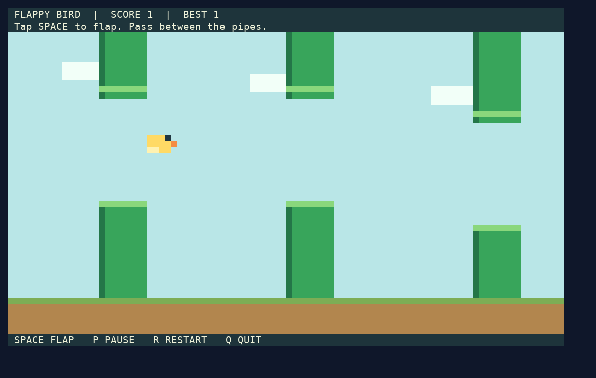
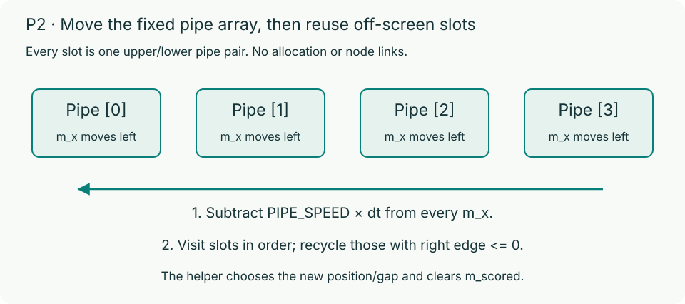
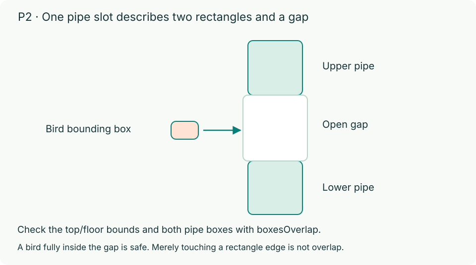
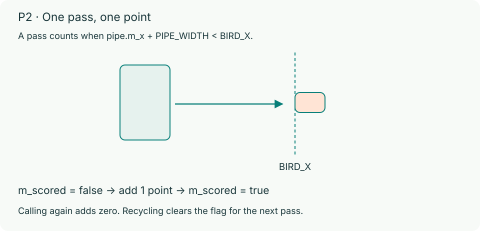

# Problem 2: Flappy Bird (40 automatic points)

Complete four functions in `p2/flappy.c` for a C17 terminal Flappy Bird game. Tap **Space** to flap. The bird stays at `BIRD_X` while pipe pairs scroll left; each passed pair earns one point. No linked list or dynamic allocation is needed.



> **Note:** The preview uses a sample font. Colors and proportions depend on your terminal.

## Build and play

From `hw4/`, on macOS or Linux with a UTF-8 ANSI terminal:

```bash
make debug
(cd p2 && ./build/flappy-debug)
```

`Space` starts, flaps, or retries after a collision. `P` pauses, `R` returns to the ready screen, and `Q` quits. Results remain visible until retry. The game is silent and reads individual keypresses, not key releases. The framework keeps the best score for the current process.

Read `flappy.h` for public types, constants, and helpers; do not modify it. The starter draws and accepts input, but its four student functions are incomplete. `make release` or plain `make` builds `p2/build/flappy`.

## Framework and data

The framework handles input, bird physics, gap generation, drawing, pause, and retries. Each physics update applies bird motion, calls `advancePipes(game, STEP)`, checks `birdHitsObstacle(game)`, and calls `scorePassedPipes(game)` only if the bird survives. It manages `READY`, `PLAYING`, `DEAD`, and `m_best`.

`Game` contains `Pipe m_pipes[PIPE_COUNT]`, bird position `m_bird_y`, velocity `m_vy`, elapsed time `m_elapsed`, score `m_score`, best score `m_best`, and status `m_status`.

Each `Pipe` has `float m_x` (left edge), `float m_gap_y` (gap's top edge), and `bool m_scored` (whether this pair has earned a point). One slot represents both pipes. Their width is `PIPE_WIDTH`; the lower pipe begins at `m_gap_y + PIPE_GAP_HEIGHT`.



## Functions to write

### 1. advancePipes (10 automatic points)

```c
void advancePipes(Game *game, float dt);
```

Precondition: `dt` is finite and nonnegative. Decrease every pipe's `m_x` by `PIPE_SPEED * dt`. Recycle each slot satisfying `m_x + PIPE_WIDTH <= 0` by calling `recyclePipe(game, index)`, in ascending index order.

> **Important:** Every pipe must have its updated position before the first recycling call. The helper uses the current positions to find the rightmost pipe. A zero `dt` still requires recycling eligible slots, including exact equality at the boundary.

The helper places the recycled slot after the current rightmost pipe, outside the view, generates its gap using `nextRandom(0)`, and resets `m_scored` to `false`. Use this helper rather than a custom gap generator. Do not resize the array. Unrecycled slots retain their `m_gap_y` and `m_scored` values.

### 2. birdHitsObstacle (14 automatic points)

```c
bool birdHitsObstacle(const Game *game);
```

Return whether the bird crosses the playable vertical bounds or overlaps any pipe. Do not modify `*game`. Use `gameBirdBox(game)` for the bird's `Box` (`m_x`, `m_y`, `m_width`, `m_height`).

The playable area is `[0, FLOOR_Y]`. A collision occurs when `bird.m_y < 0` or `bird.m_y + bird.m_height > FLOOR_Y`; exact ceiling or floor contact is safe.

Use `boxesOverlap` with the bird and both rectangles of every pipe:

| Rectangle | Top-left (`m_x`, `m_y`) | Width | Height |
| --- | --- | --- | --- |
| Upper pipe | `{pipe.m_x, 0}` | `PIPE_WIDTH` | `pipe.m_gap_y` |
| Lower pipe | `{pipe.m_x, pipe.m_gap_y + PIPE_GAP_HEIGHT}` | `PIPE_WIDTH` | `FLOOR_Y - pipe.m_gap_y - PIPE_GAP_HEIGHT` |

Overlap requires positive intersection on both axes. Shared edges or corners alone are safe, as is fitting completely inside the gap. Use the named constants, not hardcoded dimensions.



### 3. scorePassedPipes (12 automatic points)

```c
int scorePassedPipes(Game *game);
```

For every unscored pipe whose right edge is **strictly left** of the bird's left edge (`pipe.m_x + PIPE_WIDTH < BIRD_X`), award one point and set `m_scored = true`. Equality does not count as passed. Add all new points to `game->m_score` and return their count, not the total score.

A pass scores only once until recycling resets its flag; multiple pipes may score in one call. Leave all other state unchanged, including positions, gaps, `m_best`, and `m_status`.



### 4. nextRandom (4 automatic points)

```c
unsigned int nextRandom(unsigned int seed);
```

Implement this separately in `p2/flappy.c` and `p1/snake.c`, with the same contract. Keep state in **one function-local `static unsigned int`**, initially `RANDOM_INITIAL_SEED`. Use unsigned arithmetic and named constants. Do not use globals, struct members, `rand`, or `srand`; do not allocate memory or modify game structs.

| Constant | Value |
| --- | ---: |
| `RANDOM_INITIAL_SEED` | 100 |
| `RANDOM_MULTIPLIER` | 109 |
| `RANDOM_INCREMENT` | 1021 |
| `RANDOM_MODULUS` | 32768 |

A positive seed replaces the previous state with `seed % RANDOM_MODULUS`; zero retains the previous state. Then advance and return the state:

`state = (RANDOM_MULTIPLIER * state + RANDOM_INCREMENT) % RANDOM_MODULUS`

Normalization must precede the recurrence. Every result is in `[0, RANDOM_MODULUS)`.

| Calls, in order | Results |
| --- | --- |
| `nextRandom(1)`, `nextRandom(0)`, `nextRandom(0)` | `1130`, `25887`, `4656` |
| `nextRandom(1)` again | `1130` again |
| `nextRandom(32768)` | `1021` |

Without a prior positive seed, the first two `nextRandom(0)` calls return `11921` and `22458`. The framework seeds once at startup and uses zero for new gaps. Round retries and replacing a `Game` do not reset the sequence; a new process starts fresh.

## Debug and submit

Design your own boundary tests in addition to playing. Use `make debug` and `./build/flappy-debug` for ASan and UBSan checks. See [Debugging](debugging.md) for reports and test-driver placement, and follow the [repository and formatting rules](code-style.md).

P2 has an in-person staff check on your last submission where you must explain and modify your own code (6 points), plus code organization (4 points). See [Grading](grading.md).
