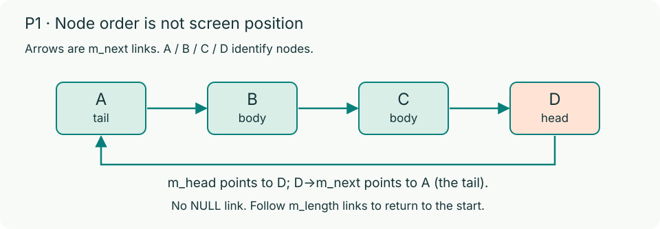
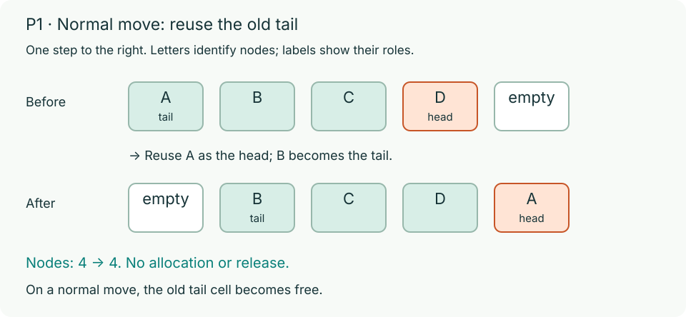

# P1: Circular-list Snake (40 automatic points)

In Problem 1, you complete six C17 functions in `snake.c` to power a terminal Snake game. Read `snake.h` first for the struct types, constants, and function declarations. The framework already provides food placement, keyboard input, terminal drawing, timing, pause, and restart. Each food you eat adds 1 point and 1 body node; reach 10 points to win. Hitting a wall or the snake's own body ends the game.

## One move in memory



You must store the snake's body as a singly linked circular list where **`m_head->m_next` is the tail**. Following `m_next` walks from the tail through the body to the head, and one more step returns to the tail. A one-node snake points to itself, and a nonempty ring never contains a `NULL` link.



- **Normal move (`grow == false`):** reuse the old tail as the new head, with no allocation, freeing, or shifting coordinates across the body. Entering the old tail cell is allowed.
- **Growth (`grow == true`):** add one new head and keep the old tail in place. Entering the old tail cell is a self-collision.
- A failed step leaves every original link, coordinate, and field unchanged.

| Function | Task |
| --- | --- |
| `snakeInit` | Build the starting ring facing right; clean up any partial allocations on failure |
| `snakeNextPosition` | Compute the next head position without modifying the snake; handle reverse and invalid directions |
| `snakeContains` | Return whether any node occupies a cell |
| `snakeStep` | Check wall/body collisions, then move or grow; keep state unchanged on any failure |
| `snakeDestroy` | Free all nodes and reset `*snake` to zero; handle empty snakes and repeated calls safely |
| `nextRandom` | Maintain one function-local `static unsigned int`, normalize positive seeds, and advance the recurrence |

For full function contracts and edge cases, read the [P1 handout](../docs/p1.md). Keep the public interface in `snake.h` unchanged and use the circular list (not an array). You may add helper functions in `snake.c`.

## Run and debug

In `p1/`, build and run with a macOS or Linux C compiler and Make:

```bash
make
./build/snake
```

The starter exits with a setup message because `snakeInit` returns `false`. Initialization alone does not make it playable: the `snakeStep` stub ends the first movement tick with an out-of-memory result. Complete all six functions for correct play, food placement, and cleanup.

Plain `make` builds the optimized release binary (`make release`, `-O2`). Use `make debug` to compile with debug symbols, AddressSanitizer, and UndefinedBehaviorSanitizer into a separate executable:

```bash
make debug
./build/snake-debug
```

Design your own boundary tests and use sanitizer reports to find root causes. See [Debugging](../docs/debugging.md).

In the game, `WASD` or arrow keys turn, `P` pauses, `R` restarts, and `Q` quits. Direct reverse turns are ignored when `m_length > 1`. If your terminal window is too small, enlarge it when prompted.

## Display and submission

Use a UTF-8 truecolor terminal. If the board cells look stretched, run `./build/snake --calibrate`, adjust the width with `+` or `-`, and press `Enter` to save. Your terminal's font and line spacing still affect physical proportions, and display calibration is not graded.

> **Important:** Keep `hw4/p1/` complete and clean generated files before submitting. Do not commit a nonempty `build/` directory or `.snake-ui.conf`. A formatting check failure in P1 gives `0` for P1's 40 automatic points, and prohibited repository files give `0` for the entire assignment's 80 automatic points. Read the [repository and code style rules](../docs/code-style.md).

## Random state

`nextRandom(unsigned int seed)` is one of your six functions in `snake.c`. Store the state in **one function-local `static unsigned int`** initialized to `RANDOM_INITIAL_SEED` (`100`). Do not use a global variable, a struct member, `rand`, or `srand`.

See the [P1 handout](../docs/p1.md) for constants, recurrence, seed rules, and examples. The framework seeds once at startup; round restarts continue the sequence.

P1 has an in-person staff check on your last submission where you must explain and modify your own code (6 points), plus code organization (4 points).
