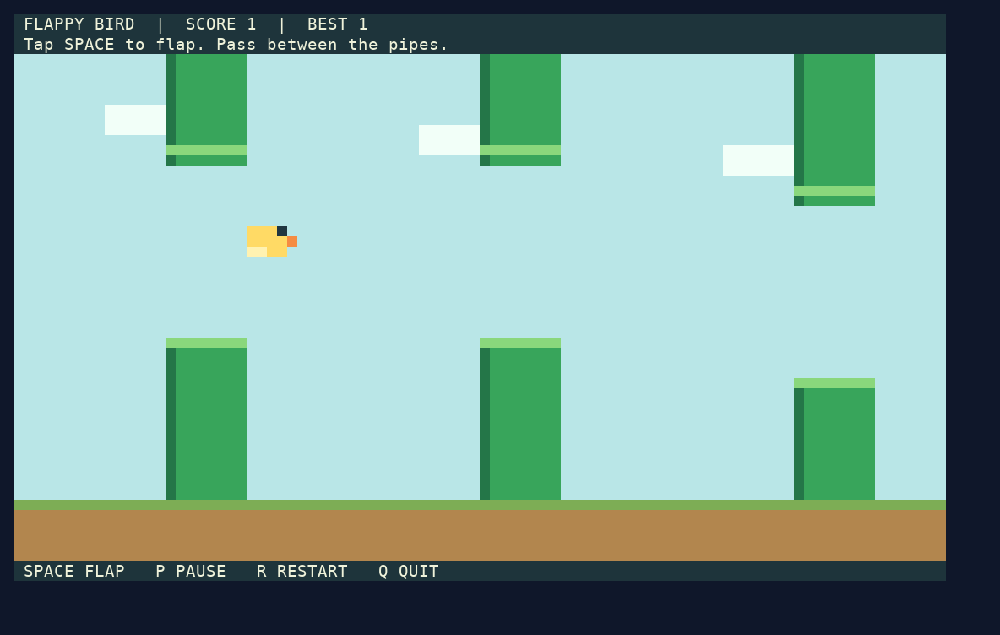
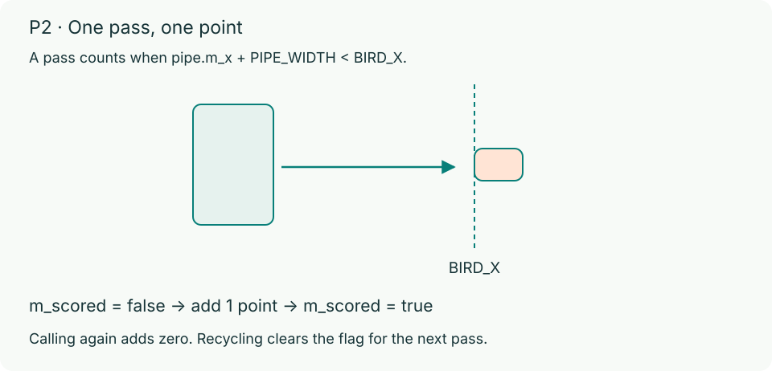

# P2: Flappy Bird (40 automatic points)

In Problem 2, you will complete the game logic for a terminal Flappy Bird game in C17. **Tap Space to flap upward.** Your bird stays at `BIRD_X` while pipe pairs scroll left across the screen; fly through each gap to earn one point. `Space` also starts the first run and retries after a collision. You do not need direction-key combinations, key-release events, dynamic memory allocation, linked lists, or special editor setup.

Start by reading `flappy.h` and the [full P2 handout](../docs/p2.md). You will implement four functions in `flappy.c`:

| Function | Points | What it does |
| --- | ---: | --- |
| `advancePipes` | 10 | Move every pipe left by `PIPE_SPEED * dt`, then recycle slots with `m_x + PIPE_WIDTH <= 0` from index `0` upward using `recyclePipe` |
| `birdHitsObstacle` | 14 | Return whether the bird crosses `[0, FLOOR_Y]` or overlaps any upper or lower pipe rectangle (using `gameBirdBox` and `boxesOverlap`) |
| `scorePassedPipes` | 12 | Mark newly passed pipes (`m_x + PIPE_WIDTH < BIRD_X`), add to `game->m_score`, and return the new points earned in this call |
| `nextRandom` | 4 | Keep one function-local `static unsigned int` (initially `RANDOM_INITIAL_SEED`), reseed when `seed > 0`, and advance the LCG recurrence |




The framework handles initialization, gravity, flapping, keyboard input, gap placement, terminal drawing, pause, result screens, and retry using a fixed array `m_pipes[PIPE_COUNT]`. Do not modify `flappy.h`.

## Build and run

In `p2/`, on macOS or Linux with a UTF-8 ANSI terminal:

```bash
make debug
./build/flappy-debug
```

You can also run `make release` or plain `make` to build `./build/flappy`. The game has no sound in either build. The starter compiles and accepts `Space`, but pipe movement, collisions, and scoring wait for your four functions in `flappy.c`.

Controls:

- `Space`: start the run, flap upward, or retry from the result screen (results stay visible until you retry).
- `P`: pause or resume.
- `R`: return to the ready screen.
- `Q`: quit.

## Random state (`nextRandom`)

`nextRandom(unsigned int seed)` is implemented in `flappy.c` (with the same contract as in [Problem 1](../docs/p1.md)):

- Store state in **one function-local `static unsigned int`** initialized to `RANDOM_INITIAL_SEED` (`100`). Do not use a global variable, a struct member, `rand`, or `srand`.
- If `seed > 0`, first normalize `state = seed % RANDOM_MODULUS`; if `seed == 0`, keep the current `state`. Then set `state = (RANDOM_MULTIPLIER * state + RANDOM_INCREMENT) % RANDOM_MODULUS` and return `state`.
- The framework seeds `nextRandom` once at program startup and calls `nextRandom(0)` for new pipe gaps. Retrying a round continues the sequence; starting a new process starts over.
- Published examples: `nextRandom(1)`, `nextRandom(0)`, `nextRandom(0)` return `1130`, `25887`, `4656`; `nextRandom(32768)` returns `1021`. See the full handout for the remaining examples.

## Check and submit

Design your own boundary tests and run `./build/flappy-debug` with ASan and UBSan. See [Debugging](../docs/debugging.md).

> **Important:** Before submitting to Gradescope, format your student code with `clang-format` 18 and clean all build outputs (`make clean`). A formatting failure in P2 gives `0` for P2's 40 automatic points (P1 is checked independently). Committing a nonempty `build/` directory (even with `.gitkeep`), compiled binaries, or prohibited cache files gives `0` for the entire 80 automatic points. See the root README, [Code Style](../docs/code-style.md), and [Grading](../docs/grading.md).

P2 has an in-person staff check on your last submission where you must explain and modify your own code (6 points), plus code organization (4 points).
